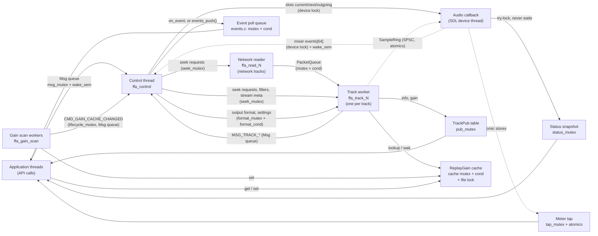
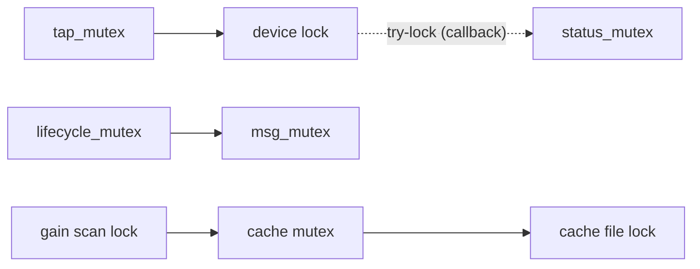
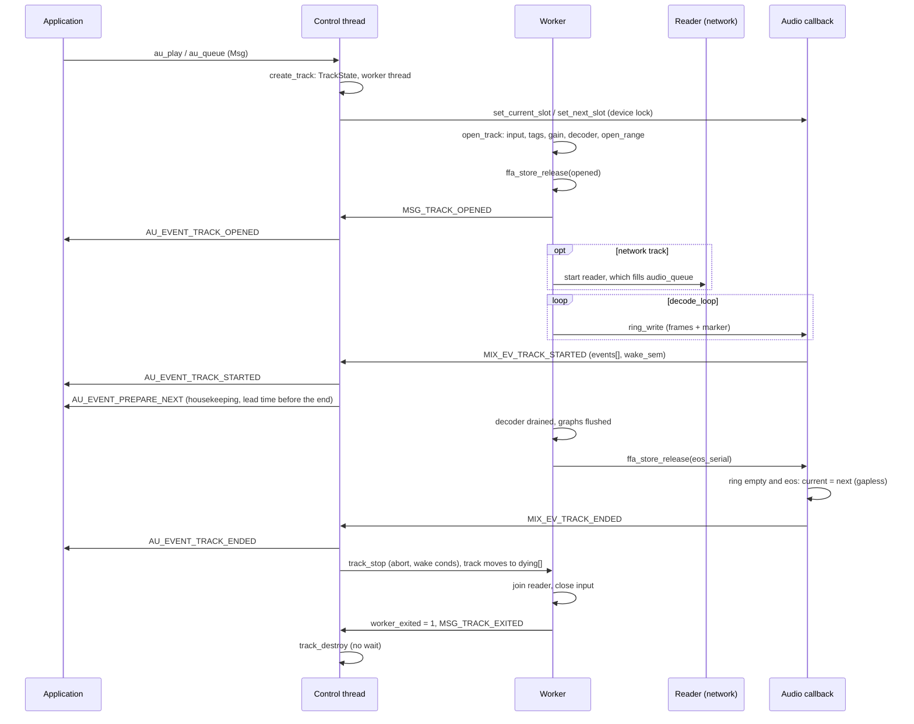

# ffaudio threading model

This is the reference for how ffaudio's threads work together: which threads exist, what each one owns, every lock,
condition, semaphore and lock-free channel, the order locks may be taken in, and the hand-offs that have to happen in
a particular order. It describes the code as it is (3.2), and it is kept up to date with it.

**Keep it true.** A change that adds a thread, a lock, a cross-thread field or a new hand-off updates this file in
the same commit. When code and this file disagree, one of them has a bug. The chaos build (see
[Chaos testing](#chaos-testing)) puts random delays at the hand-off points listed here; a new hand-off gets a
`CHAOS()` point too.

Source of the facts below: `lib/globals.h` (shared structures and their comments), `lib/ffaudio.c` (API, control
thread), `lib/track.c` (track threads), `lib/output.c` (audio callback, mixer), `lib/sample_ring.c` (decoded-audio
ring), `lib/packet_queue_utils.c`, `lib/events.c`, `lib/meters.c`, `lib/gain_cache.c`, `lib/gain_scan.c`.

## Threads

| Thread | Created by | Name | How many | Lifetime | What it does | Waits on |
|---|---|---|---|---|---|---|
| **Application** | the application | - | any | - | Calls the API. Every call except `au_shutdown()` returns without waiting for another thread. Getters copy a snapshot under a short lock. | `au_wait_event()` (event queue cond); `au_shutdown()` (shutdown semaphore, then joins the control thread) |
| **Control** | `au_init()` | `ffa_control` | 1 | `au_init()` to `au_shutdown()` | Owns every `TrackState` (creation, mixer slots, destruction), handles messages, turns mixer events into application events, calls `on_event`, opens and reopens the device, housekeeping (prepare-next, buffering notes, device list, now-playing). | `wake_sem` with a timeout: 50 ms while tracks exist (`CONTROL_PLAYING_MS`), 500 ms idle (`CONTROL_IDLE_MS`) |
| **Audio callback** | SDL, for the open device | SDL's (SDL2: `SDLAudioP<n>`) | 1 per open device | while the device is open and unpaused | `sdl_audio_callback()`: the mixer. Pulls from the track rings, fades, ReplayGain, crossfades, gapless handover, volume, dither, the meter tap, the status snapshot. | **never** (see [Real-time rules](#real-time-rules)) |
| **Track worker** | control thread, `track_create()` | `ffa_track_<handle>` | 1 per track | track creation until it has stopped and is destroyed | `track_thread()`: opens the input, reads tags and gain, opens the decoder (`open_track()`), then `decode_loop()`: decode, trim (ranges, seeks), convert graph, speed graph, user graph, write the ring. For **local** files it also reads packets and does seeks itself (`local_get_packet()`). | `ring_cond` (room in the ring), `continue_read_thread` (seek/abort when at the end), `format_cond` (no output device yet), the gain cache (`gain_cache_wait()`, a measurement it asked for), the packet queue cond (network tracks) |
| **Network reader** | the track's worker | `ffa_read_<handle>` | 1 per network track | from after the open until the worker's decoding ends | `net_reader()`: reads packets ahead into the track's `audio_queue`, does seeks and range ends for the stream, reconnects, ICY/Ogg "now playing". | `continue_read_thread` (queue full, at the end, after errors) |
| **Gain scan worker** | first request (`start_workers()`) | `ffa_gain_scan` | up to `AuGainScanConfig.threads` (max 16) | until `au_gain_scan_stop()`, or until fewer are wanted | `worker_main()`: measures files for the ReplayGain cache, calls `on_cached`. Runs without a player too. | gain scan `wake` cond |
| **SDL event watch** | SDL | whichever thread adds an event to SDL's queue | - | - | `device_event_watch()`: sets `device_events` / `open_device_lost` atomics only. | never |
| **FFmpeg internal** | FFmpeg | - | per decoder | - | Frame/slice threads of a decoder (`ff_open_decoder(threads)`). Filter graphs run single-threaded (`filter_nbthreads = 1`). Can call `av_log` → `ffmpeg_log()` → `ff_log()`. | - |

Application code runs on exactly these threads:

- `AuConfig.on_event`: the **control thread** only (`dispatch_notes()`), never while a lock is held. It may call any API
  function except `au_shutdown()`.
- `AuGainScanConfig.on_cached`: a **gain scan worker**, without the scan lock held (`notify()`).
- Without `on_event`, events wait in the poll queue and the application reads them with `au_poll_event()` /
  `au_wait_event()` on any thread.

## Diagram

Arrows are data or signals. Lock-free channels are dashed.



## Synchronisation objects

### Per player (`AudioPlayer`, `lib/globals.h`)

| Object | Kind | Guards / signals | Taken by | Notes |
|---|---|---|---|---|
| `msg_mutex` | mutex | the message list `msg_head`/`msg_tail` | any thread (`msg_post()`), control thread (takes the whole list) | Held only to link or take the list. Never held while taking another lock. |
| `wake_sem` | semaphore | wakes the control thread | `msg_post()` (every message), audio callback (when it pushed a mixer event, `m->wake_control`) | `SDL_SemPost` never blocks, so the callback may post it. |
| `started_sem` | semaphore | `control_thread_id` is set | control thread posts once, `au_init()` waits | Lets callbacks recognise the control thread (`on_control_thread()`). |
| `Msg.done` (shutdown) | semaphore | `CMD_SHUTDOWN` is complete | `au_shutdown()` waits, control thread posts (`finish_sync()`) | The only API call that waits. |
| **device lock** (`lock_mixer()` = `SDL_LockAudioDevice`) | SDL's lock | `Mixer` slots and every field the callback reads besides atomics: `current`, `next`, `outgoing`, fades, `events[]`, `n_events`, the tap's `buf`/`frames`/`channels`/`rate`/`gen`, `TrackState.fade_reason` | audio callback (held by SDL for the whole callback), control thread | Held briefly. Nothing is waited for under it; the control thread never takes another lock while holding it. |
| `format_mutex` + `format_cond` | mutex + cond | output format (`audio_target`, `output_ready`, `device_in_use`), settings read by workers: global/source/downmix/upmix filters, `replaygain`, `speed`/`keep_pitch`/`speed_gen` | control thread writes; workers read (and wait on the cond for a device: `ensure_convert_graph()`); `au_set_*` read some | `track_stop()` broadcasts the cond so a waiting worker sees its abort at once. |
| `status_mutex` | mutex | `StatusSnapshot status` | audio callback (**try-lock**: skips a period when busy), control thread (`publish_idle_status()`), getters (`au_get_status()`, `read_status()`, meters, `resolve_handle()`) | A mutex, not a spin lock, so ThreadSanitizer follows it. Held for a struct copy. |
| `pub_mutex` | mutex | `TrackPub` table (`au_track_info()`, `au_track_gain_db()`) | control thread (`pub_add()` in `create_track()`, `pub_remove()` in `end_track()`, `pub_clear()`), workers and the control thread for now-playing (`ff_publish_info()`, `ff_publish_gain()`), getters | **Innermost**: nothing is taken while it is held. Getters resolve handle 0 from the status *before* taking it. |
| `ring_pool_mutex` | mutex | spare ring storage `ring_pool[4]` | workers (`ring_storage_take()`), whoever destroys a track (`ring_storage_give()`) | Leaf. |
| `tap_mutex` | mutex | the meter tap's buffer lifetime | meter readers (any thread), control thread (`tap_install()`) | Taken **before** the device lock (`tap_install()`); the callback never takes it. |
| `lifecycle_mutex` (static, `ffaudio.c`) | mutex, created once | `audio_player` while it is set or cleared, against a cache update posting to a dying player | `au_init()`, `au_shutdown()`, `ff_gain_cache_changed()` (any thread) | Held across `msg_post()` (so: `lifecycle_mutex` → `msg_mutex`). |

### Per track (`TrackState`)

| Object | Kind | Guards / signals | Taken by | Notes |
|---|---|---|---|---|
| `seek_mutex` | mutex | seek requests (`seek_req`, `seek_pos`, `pending_seek_percent`), the seek handoff (`seek_done_serial`, `seek_done_sample`, `seek_done_base`), `filtergraph_str`, `filter_cmds`, `stream_meta`, `info` | control thread (requests, filter changes, now-playing), worker (seeks for local files, filters, trimmer), reader (seeks for streams, stream meta) | Nothing that waits is done under it; publications to `pub_mutex` happen after it is released. |
| `wait_mutex` + `continue_read_thread` | mutex + cond | wakes whoever reads the file (worker for local files, reader for streams) | waiters: `wait_ms()`, `wait_for_request()`; signalled by `wake_read_thread()` (seek requests, filter changes, `track_stop()`) | `wait_for_request()` re-checks `abort_request` and `seek_pending` under the mutex before waiting, `wait_ms()` `abort_request`, so a wake-up between check and wait is not lost; both wait with a timeout. |
| `ring_mutex` + `ring_cond` | mutex + cond | wakes a worker waiting for room in its ring | worker waits in `ring_wait_room()` (with a timeout, from the fill level); `wake_producer()` from seeks and `track_stop()` | The **mixer never signals it** (it must not); the worker's timeout covers the ring draining. |
| `audio_queue` (`PacketQueue`): `mutex` + `cond` | mutex + cond | packets, `serial`, `abort_request` | reader puts, worker takes (network); `packet_queue_flush()` on seeks (bumps the serial); `packet_queue_abort()` | `serial_atomic` and `abort_atomic` mirror the two fields for lock-free readers (decoder, callback). Local tracks use the queue only for its serial and abort flag. |
| `ring` (`SampleRing`) | lock-free SPSC | decoded float frames + markers (`start`, `frames`, `serial`, `rate`, `channels`, `pts`, `speed`) | worker writes, audio callback reads | See [the ring](#the-decoded-audio-ring). |

### Process-wide (not per player)

| Object | File | Guards | Notes |
|---|---|---|---|
| event queue `mutex` + `cond` (created once) | `events.c` | the poll ring (64 growing to 4096 entries), `dropped`, `polled` | `events_push()` (control thread; also the application's thread for `au_init()`'s own failure log, `early_log()`), `au_poll_event()` / `au_wait_event()` (any thread). When full, logs go first, then the oldest events; readers get `AU_EVENT_OVERFLOW`. `events_close()` broadcasts so `au_wait_event(-1)` returns at shutdown. Leaf. |
| cache mutex + `cache_changed` cond (created once) | `gain_cache.c` | the in-memory ReplayGain table, the file state, failure marks | any thread (API), workers (`gain_cache_lookup()`, `gain_cache_wait()`), scan workers. `gain_cache_wait()` waits on the cond in 20 ms steps, re-checking its abort flag. Not held while calling out: `ff_gain_cache_changed()` comes after it is released. |
| cache file lock (`<cache>.lock`, `LockFileEx` / `flock`) | `gain_cache.c` | appends and compaction **across processes** | taken under the cache mutex, around one append or a compaction. On Windows the cache file is closed after each append, so another process can replace it when compacting. |
| scan `lock` + `wake` cond (created once) | `gain_scan.c` | the job list and index, `workers[]`, `config`, `pending` | API calls, scan workers. Workers wait on `wake`; `au_gain_scan_stop()` sets `stopping`, broadcasts, joins. Held while dropping jobs, which notes failures in the cache (scan `lock` → cache mutex). |
| network settings `lock` (created once) | `network.c` | `AuNetworkConfig settings` | any thread; copied out under it (`network_config()`). Leaf. |
| `FfOnce` flags | `once.h` users | one-time creation of the static mutexes above, the C locale (`numbers.c`) | `pthread_once` / `InitOnceExecuteOnce`. |

## Atomics and lock-free values

`lib/atomics.h` wraps GCC/Clang `__atomic` (and MSVC interlocked) operations as `ffa_load_acquire`,
`ffa_store_release`, `ffa_load_relaxed`, `ffa_store_relaxed`, `ffa_fetch_add`, `ffa_cas`, on `int32_t`. Unlike
`SDL_atomic_t`, ThreadSanitizer understands their ordering, so **anything that publishes other data uses them**. Plain
flags that publish nothing stay `SDL_atomic_t`.

| Value | Writer → readers | Ordering and meaning |
|---|---|---|
| `TrackState.opened` | worker → control thread, callback | `ffa_store_release(1)` after `open_range()` set the range, `duration_s` and the decoder; readers `ffa_load_acquire` before reading them (`track_duration()` is called by the callback). They never change afterwards. |
| `TrackState.eos_serial` | worker → callback | release after the last frames of that serial are in the ring. The callback reads it **before** looking at the ring: an empty ring after a set marker really is the end. Also set by `read_thread_fail()` / `fail_track()`: nothing more comes. |
| `SampleRing.write_marker` / `read_marker` | worker / callback | release-acquire pairs hand markers and their frames over (see below). |
| `MeterTap.written`, `published`, sample bits | callback → meter readers | `written` (relaxed) before the data, each sample stored with release, `published` (release) last. Readers: `published` (acquire), samples (acquire), then `written`: if it moved past their start, they read again. |
| `TrackState.gain_mb` (`SDL_atomic_t`) | any thread → callback | target gain and its "slow" bit packed in one value (`gain_pack()`), so the flag can not outlive its value. |
| `AudioPlayer.volume` (float bits), `muted`, `paused`, `loop_count` | API / control thread → callback, getters | plain values. |
| `AudioPlayer.pause_state` | API threads, control thread | bit 0 = paused as last set, the rest a call counter; the control thread's own unpause uses CAS against the state its message carried, so it can not undo a newer `au_pause()`. |
| `TrackState.loops_remaining` | API (via control) → worker | taken with a CAS loop (`take_loop()`), so a concurrent `au_set_loop_count(0)` can not turn into -1. |
| `TrackState.loops_started` / `loops_heard` | worker counts / callback compares | a loop is reported only if the worker really looped. |
| `abort_request`, `seek_pending`, `worker_exited`, `buffering`, `buffered_ms`, `read_ended`, `filter_reconfigure`, `user_filters_changed`, `had_error` | as named | flags; `seek_pending` is set under `seek_mutex` and cleared when the request is done; `worker_exited` is the worker's very last store before its exit message (then the track may be freed without waiting). |
| `PacketQueue.serial_atomic`, `abort_atomic` | queue mutex holders → lock-free readers | mirrors of the guarded fields. |
| `device_events`, `open_device`, `open_device_lost` | event watch ↔ control thread | flags, taken with `SDL_AtomicSet(…, 0)`. |
| `tap_requested` | meter readers → control thread | CAS 0→1 posts `CMD_ENABLE_TAP` once. |
| `shutting_down`, `handle_count`, `request_count` | as named | counters / flags. |
| `AuMediaInfo` `refs` | any thread | reference count (`media_info_retain()` / `au_media_info_release()`); the block is immutable. |
| gain scan `stopping`, `workers[i].cancel` | API → scan workers | read while measuring without the lock (the interrupt callback). |

## Lock order

Locks are taken in this order only (left before right). Locks not shown are leaves: nothing is taken while they are
held. This was checked with a scan of every nested acquisition (`lock_scan.py` in the development notes) and by
reading each case.



Rules:

1. **Nothing waits under the device lock**, and the control thread takes no other lock while holding it: inside
   `lock_mixer()` it only calls the mixer's own slot and fade functions (`set_current_slot()`, `set_next_slot()`,
   `remove_from_mixer()`, `mixer_has_track()`, `mixer_start_transition()`, `mixer_set_pause()`, `fade_for()`), which
   take no locks. The one lock held around it is `tap_mutex` (`tap_install()`).
2. The audio callback's only lock is the **try-lock** of `status_mutex`. It never takes `tap_mutex`, `format_mutex`,
   `seek_mutex`, `ring_mutex` or the queue mutexes.
3. `pub_mutex`, `msg_mutex`, `ring_pool_mutex`, the event queue mutex, the network `lock`, `wait_mutex`, `ring_mutex`
   and the packet queue mutex are **leaves**. `ff_log()` (which takes `msg_mutex`) may be called while holding any
   lock except a leaf.
4. Getters take `status_mutex` and `tap_mutex` one after the other, never nested (`au_get_levels()` releases the
   status before it takes the tap).
5. A thread never waits for another thread while holding a lock that thread needs. The waits that join threads
   (`SDL_WaitThread`) happen with no ffaudio lock held: the worker joins its reader, the control thread destroys
   tracks only once `worker_exited` says the worker has returned, `au_gain_scan_stop()` joins scan workers after
   releasing the scan lock.

## Ownership

Who may touch what, beyond the locks above.

| Data | Owner |
|---|---|
| `AudioPlayer.tracks[]`, `dying[]`, `known_devices`, crossfade settings and curves, `prepare_next_seconds`, `output_channels`/`output_sample_rate`, `tap_enabled`, the note list (`notes`) | control thread only |
| `TrackState.ended`, `prepare_next_sent`, `duration_reported`, `reported_duration`, `buffering_reported` | control thread only |
| `TrackState` playback cursor: `position`, `last_frame_pts`, `play_speed`, `started`, `announced`, `loops_heard`, `last_frame_serial`, `gain_cur`/`gain_step`/…, `stalled`, `resume_fade`, `play_clock`, `clock_serial` | audio callback only |
| `Mixer` (everything) | audio callback, and the control thread under the device lock |
| `TrackState` decode state: `ic` (after open), decoder, `convert`/`speed_chain`/`user` graphs, `trim`, `range_end_hit`, `audio_filter_src`, speed segment fields | worker only. For network tracks `ic` belongs to the reader once it runs. |
| `TrackState` range fields (`has_range` … `duration_s`) | worker, before `opened`; read-only after |
| `TrackState` read state: `demux_eof`, `read_clock`, `last_pkt_ts`, `ts_shift`/`ts_next`, `icy`, `last_icy`, `last_meta`, `read_errors` | whoever reads the file: the worker (local), the reader (network) |
| `TrackState` creation fields (`filename`, `range_start_s`, `range_len_s`, overrides, `network`, buffer targets) | written by the control thread before the worker starts; read-only after |

## The decoded-audio ring

`SampleRing` (`lib/sample_ring.c`) is a single-producer single-consumer ring between a track's worker (producer) and
the audio callback (consumer):

- Storage of float frames (a power of two, at least `DECODED_BUFFER_SECONDS` = 0.5 s plus one chunk) and 256 markers,
  one per chunk written.
- The producer writes frames, fills the marker, then `ffa_store_release(write_marker)`. The consumer
  `ffa_load_acquire(write_marker)`, reads, and `ffa_store_release(read_marker)` when a marker is done, which hands its
  storage back.
- Producer-only functions (`ring_used_frames`, `ring_has_room`, `ring_capacity`, `ring_set_storage`, `ring_write`) and
  consumer-only ones (`ring_peek`, `ring_read`, `ring_skip`, `ring_has_frames`, `ring_offset`) must not be mixed up:
  the consumer must not read `ring_capacity()` (the storage may be replaced while nothing is pending).
- Markers carry the serial: after a seek, the callback drops stale markers (`drop_stale()`) without waiting, also
  while paused.
- The worker waits for room on `ring_cond` with a timeout; the callback never signals.

## Lifecycles

### `au_init()`

1. Allocate the player, create its mutexes and semaphores, `events_open()`.
2. `av_log_set_callback(ffmpeg_log)`, `SDL_InitSubSystem(AUDIO | EVENTS)`, `SDL_AddEventWatch(device_event_watch)`.
3. Under `lifecycle_mutex`: `audio_player = ap`.
4. Start the control thread; wait on `started_sem` until it has stored its thread id.
5. `au_set_device()` posts the device open; `AU_EVENT_DEVICE` reports the result. `au_init()` returns without waiting
   for it. Tracks started before the device opens wait in `ensure_convert_graph()` on `format_cond`.

### A track



The steps of destruction:

1. **Ended**: `end_track()` sets `t->ended`, removes it from `TrackPub`, notes `AU_EVENT_TRACK_ENDED`. That happens
   exactly once per handle, whichever path ends it: mixer end, fade done, skip/stop/replace, failure, shutdown.
2. **Left the mixer**: `destroy_ended_tracks()` waits until no slot holds it (the callback may still be fading it out).
3. **Stopping**: `track_stop()` sets `abort_request`, aborts the packet queue, wakes `ring_cond`,
   `continue_read_thread` and `format_cond`. The track moves to `dying[]`. The control thread never joins a worker
   that is still running (one may be stuck in a DNS lookup).
4. **Exited**: the worker joins its reader, closes the input, stores `worker_exited = 1`, posts `MSG_TRACK_EXITED`.
5. **Destroyed**: `track_destroy()` joins (without waiting) and frees.

### Seeks

1. API → control thread (`CMD_SEEK`, `CMD_SEEK_PERCENT`) → `track_request_seek()` stores the request under
   `seek_mutex`, sets `seek_pending`, wakes the reader side (`continue_read_thread`) and the worker (`ring_cond`).
2. Whoever reads the file (worker or reader) runs `process_seek_request()`: seek the demuxer, `packet_queue_flush()`
   (a new serial), then the handoff under `seek_mutex` (`seek_done_serial`, exact target sample, seek base), then
   `MSG_TRACK_SEEKED`.
3. The handoff is stored **before** any packet of the new serial can be read (the same thread reads them), so the
   trimmer (`trim_begin()`) always finds it for the new serial.
4. The decoder flushes on the serial change; the callback drops stale ring markers; positions restart from the
   trimmed frames' timestamps.

### `au_shutdown()`

1. Refused on the control thread (from a callback).
2. Post `CMD_SHUTDOWN` with a semaphore and wait. The control thread runs `shutdown_tracks()`: empties the slots
   under the device lock, closes the device (the callback has stopped), stops and destroys every track (joining
   workers), then posts the semaphore and returns.
3. Join the control thread, remove the event watch, put FFmpeg's default log callback back.
4. Under `lifecycle_mutex`: `audio_player = NULL`. Free what is left, `events_close()` (wakes `au_wait_event()`).

## Hand-offs that must happen in order

Each of these was, or could be, a race. The chaos build has points between the steps of the track hand-offs (end,
failure, opening, seek, callback end) and at the entry of the functions of the others.

| Hand-off | Rule | Why |
|---|---|---|
| End of a track | The worker stores `eos_serial` **after** its last frames are in the ring; the callback reads `eos_serial` **before** the ring. | Read the other way round, the last frames could be cut. |
| A track that fails | `read_thread_fail()` / `fail_track()` store `eos_serial`, then post `MSG_TRACK_FAILED`. The control thread may see the mixer's end event first, or the failure first while the callback has already let the track go. **Whichever comes first asks for the next track** (`ask_for_next_if_idle()`): nothing current or queued, and no prepare-next sent for this track. | In either order the other path found the track dealt with and asked for nothing: playback stopped after a broken file (found on Windows, 3.2). |
| Opening | `open_range()` and the decoder are set up, then `ffa_store_release(opened)`, then `MSG_TRACK_OPENED`. `ff_publish_info()` comes before `MSG_TRACK_OPENED`. | `AU_EVENT_TRACK_OPENED` promises `au_track_info()` has the details; the callback reads `duration_s` after `opened`. |
| Seek target | the handoff is stored after `packet_queue_flush()` and before the first packet of the new serial. | The trimmer must cut to the target for that serial, not the range start. |
| Starting a track | The callback starts a track only once 1/10 s is decoded, the track has ended (all of it is there), or half the ring's markers are in use. | With a filter that holds audio back (adeclip) and SDL3, which asks for a lot when the device starts, the first frames played and a gap followed (3.2). |
| Device change | `reopen_output()` closes and opens the device on the control thread, then (format changed) cancels fades, sets `filter_reconfigure` and seeks the current track to its heard position. `tap_install()` makes a new tap buffer under `tap_mutex` then the device lock. | Readers may be copying the old tap; the callback only writes a tap made for the current format. |
| Meter tap | see the atomics table: `written` before the data before `published`. | A reader that sees new data also sees that its window was overwritten. |
| Pause from the API | `au_pause()` updates `pause_state` (bit and counter) at once; the control thread applies `paused`. An unpause by `au_queue()` starting a track is a CAS against the state its message carried. | Otherwise the control thread could undo a newer `au_pause()` (3.0). |

## Real-time rules

The audio callback (`sdl_audio_callback()` and everything it calls in `output.c` and `track_pull()` /
`track_drop_stale()` / `track_has_audio()` in `track.c`):

- never blocks: its only lock is `SDL_TryLockMutex(status_mutex)`; it only uses atomics otherwise;
- never allocates or frees;
- posts `wake_sem` (never blocks) only when it pushed a mixer event;
- never calls `ff_log()` (which allocates and takes `msg_mutex`) or any FFmpeg function;
- reads only fields that are fixed after `opened`, or atomics, or callback-owned fields, or `Mixer` fields (it holds
  the device lock);
- never signals `ring_cond` (the worker's timeout covers it).

## Chaos testing

Configure with `-DFFAUDIO_CHAOS=ON` (testing only; release builds have none of it). `lib/chaos.h` defines
`CHAOS("name")`, placed at the entry of every function that takes part in a hand-off and between the steps of the
multi-step publications above, and `CHAOS_RT("name")` in the audio callback.

At run time, `FFAUDIO_CHAOS="seed:percent:max_us"` makes each point sleep with that probability for up to `max_us`
microseconds (`CHAOS_RT` at most `max_us / 20`, capped at 300 µs, so the device keeps running). Run the whole suite
under several seeds and intensities, release and ThreadSanitizer builds:

```sh
cmake -S . -B build-chaos -DFFAUDIO_CHAOS=ON && cmake --build build-chaos
FFAUDIO_CHAOS=7:30:5000 ctest --test-dir build-chaos -j3 --output-on-failure --timeout 1200
```

A failure under chaos is either a race (fix it, and add the delay that shows it to a test if possible) or a test that
assumes timing (make the test state what it really requires). What to expect:

- **ThreadSanitizer reports** under chaos are always real: fix them.
- **Wrong audio** (a sample missing, repeated or out of order) is always real. Under `FFAUDIO_CHAOS` the counter checks
  in `tests/test_output.c` skip silent gaps, so they still check that every sample comes exactly once, in order.
- **Underruns** are expected at medium and heavy intensities: the delays slow the worker below real time, and the
  mixer plays silence until it catches up. So are failures of checks on real-time behaviour (prepare-next and
  positions within a few hundred ms, buffering counts, scan ordering, a test that floods 5000 tracks within 20 s), and
  tests passing the 180 s ctest limit (run them directly to see whether they pass).

The first campaign (2026-11-24: 3 light, 3 medium, 2 heavy release runs, 3 TSan runs) found the `update_device_running()`
race; everything else it showed was of the expected kinds above, and sample-exactness held with gaps skipped.

## History of races found

| Version | Race | Fix |
|---|---|---|
| 2.1 | The control thread did not set its own thread id, so a callback calling the API waited for itself. | The thread stores its id and posts `started_sem` before `au_init()` returns. |
| 3.0 | `au_get_status()` paused flag could be undone by the control thread's own unpause. | `pause_state` generation + CAS. |
| 3.2 | A failed current track with nothing queued: no `AU_EVENT_PREPARE_NEXT` in either arrival order. | `ask_for_next_if_idle()` on both paths. |
| 3.2 | A track started with its first frames; filters that hold audio back ran it dry on SDL3. | 1/10 s prefill (`ring_has_frames()`). |
| 3.2 | The prefill check read `ring_capacity()` from the callback while the worker replaced the storage (found by TSan). | The check uses only consumer-side state. |
| 3.2 | `handle_demux_end()` (network: the reader) wrote the worker's trim state. | Only for local files. |
| 3.2 | `update_device_running()` read the mixer slots without the device lock while the callback did a gapless handover (found by the chaos build with TSan; it had shown up once as an unexplained `test_lifecycle` failure). | The slots are read under the device lock. |
